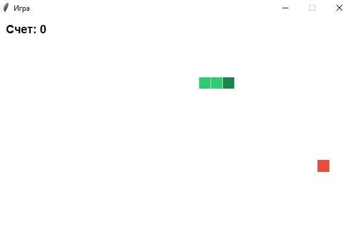

# Игра «Змейка» (Snake Game)




Классическая аркадная игра «Змейка», написанная на языке **Python** с использованием стандартной графической библиотеки **Tkinter**.

---

## Для чего создан проект
* **Обучение и практика:** демонстрация работы с графическим интерфейсом (`tkinter`), холстом (`Canvas`), обработкой нажатий клавиш и игровым циклом в Python.
* **Развлечение:** легкая и быстрая мини-игра, которая не требует установки сторонних библиотек и запускается на любом компьютере с Python.

---

## Основа игры
* **Размер игрового поля:** 600x400 пикселей (разделено на сетку с шагом 20x20 пикселей).
* **Змейка:** состоит из сегментов. При старте длина составляет 3 клетки, голова выделена темно-зеленым цветом.
* **Цель:** собирать красные квадраты (еду), которые появляются в случайных клетках поля. Каждое съеденное яблоко увеличивает длину змейки на 1 сегмент и прибавляет 1 очко.
* **Условия проигрыша:** столкновение головы змейки с границами окна или с собственным хвостом.

---

## Как играть

### 1. Запуск игры
Убедитесь, что у вас установлен Python 3. Откройте терминал (командную строку) в папке с проектом и выполните команду:
```bash
python game.py
```

### 2. Управление
* **Стрелка вверх** — движение вверх
* **Стрелка вниз** — движение вниз
* **Стрелка влево** — движение влево
* **Стрелка вправо** — движение вправо
* **Пробел (Space)** — перезапуск игры после проигрыша

---

## Требования
* **Python 3.x**
* Внешние библиотеки **не требуются** (используются только встроенные модули `tkinter` и `random`).
